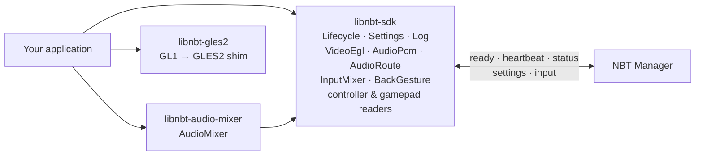

<!-- SPDX-License-Identifier: MPL-2.0 -->
<p align="center">
  <picture>
    <source media="(prefers-color-scheme: dark)" srcset="docs/assets/logo-dark.svg">
    
  </picture>
</p>

<h1 align="center">NBT App SDK</h1>

> **Warning: installing or modifying this software can brick your head unit. Recovery may require professional service or replacement, at your expense. Provided AS IS; use at your own risk, subject to applicable law.** [Read the risk and liability disclaimer](DISCLAIMER.md).

<p align="center">
  <b>Write an application for the iDrive screen</b><br>
  in plain C++11; build it for the head unit and for a Linux desktop.
</p>

The C++ SDK for applications that run under NBT Manager on BMW NBT Evo
(iDrive 6) head units. It gives an application its side of the manager's
bridge (launch, readiness, heartbeats, status, live settings, signals), the
iDrive controller and gamepad input, an OpenGL ES 2 window on the head unit's
panel, audio output with the car's audio routing, and logging that ends up in
the application's log on the car. The same code builds for the head unit
(QNX 6.5, ARMv7) and for a Linux desktop, where the window is an X11 window.

**Supported head units:** BMW NBT Evo (iDrive 6). Support for the earlier NBT
may come later.

Part of [NBTFoundry](https://github.com/NBTFoundry):
[manager](https://github.com/NBTFoundry/manager) (runs the applications) ·
[nf-doom](https://github.com/NBTFoundry/nf-doom) (an application on this SDK) ·
[mobile-app](https://github.com/NBTFoundry/mobile-app) (phone app) ·
[installer](https://github.com/NBTFoundry/installer) (desktop installer)

Not affiliated with or endorsed by BMW AG. BMW, iDrive and NBT are trademarks
of BMW AG.

## Contents



| Library | What it gives an application |
| --- | --- |
| `libnbt-sdk` | `Lifecycle` (bridge), `Settings`, log and crash lines, `VideoEgl`, `AudioPcm` and `AudioRoute`, the controller and gamepad readers, `InputMixer`, `BackGesture` |
| `libnbt-audio-mixer` | `AudioMixer`: 16 sample channels over a music renderer |
| `libnbt-gles2` | A GL1-to-GLES2 shim for porting fixed-function OpenGL code |
| `libnbt-frontend` | A front end: frames scaled to the panel, an audio queue, controls laid out per pad family, an overlay, menus, save files |
| `libnbt-retro` | A libretro host: one statically linked core as an application, with a game list, saves, states and a pause menu |

The API is described in [docs/api.md](docs/api.md); the bridge contract it
implements is `NBTFoundry/manager: docs/app-bridge.md`.

## A minimal application

```cpp
#include "nbt/app/clock.hpp"
#include "nbt/app/lifecycle.hpp"
#include "nbt/app/log.hpp"
#include "nbt/app/video.hpp"
#include "nbt/controller/input.hpp"

int main(int argc, char** argv) {
  nbt::app::log_init("hello");                  // lines in the application's log
  nbt::app::Lifecycle lifecycle;
  if (int rc = lifecycle.init(argc, argv)) return rc;
  nbt::app::log_install_crash_handlers();

  nbt::app::VideoEgl video;                     // the head unit's panel, or an X11 window
  if (lifecycle.is_user_mode() && !video.init(lifecycle.surface_id())) return 1;
  if (!lifecycle.send_ready()) return 1;        // the manager shows the application

  nbt::controller::Input controller;
  while (!lifecycle.stopping()) {
    controller.poll(lifecycle.controller_fd(), &on_controller, NULL);
    draw();
    video.swap();
    bool settings_changed = false;              // heartbeat, status line, live settings
    lifecycle.tick(nbt::app::monotonic_ms(), "Running", &settings_changed);
    if (settings_changed) apply(lifecycle.settings());
  }
  video.shutdown();
  lifecycle.close_fds();
  return 0;
}
```

## Build and test

Linux host (gcc, Python 3, X11, EGL and GLESv2 development files; Xvfb for the
window tests). Third-party code is in submodules (`third_party/`):

```sh
git submodule update --init
make -j"$(nproc)" host               # libraries, unit tests, smoke app
make test                            # unit tests, smoke tests, neutrality check
make test-asan                       # the same under AddressSanitizer/UBSan
make check-static-init               # no static constructors in any object
make check-readers NBT_MGR_DIR=../manager   # bridge readers match the manager's
```

Head unit (QNX 6.5 SDP for ARMv7; `QNX_SCREEN_LIBDIR` holds the head unit's
`libscreen.so`):

```sh
make QNX_ENV=/path/to/qnx-env.sh QNX_SCREEN_LIBDIR=/path/to/screen/lib qnx qnx-check
```

`qnx-check` rejects symbols that QNX 6.5's C++ runtime lacks
(`GLIBCXX_3.4.14` and newer, `__cxa_throw`) and checks that `kdMain` is
exported.

Libraries go to `build/lib/libnbt-{sdk,audio-mixer,gles2}-{host,asan,qnx}.a`.

## Using it from an application

Include `nbt-sdk.mk` from the application's Makefile; it builds the SDK into
the application's build folder and gives the include and link flags:

```make
NBT_SDK_DIR ?= ../sdk
NBT_SDK_BUILD_DIR := $(abspath build)/sdk
include $(NBT_SDK_DIR)/nbt-sdk.mk

CXXFLAGS += $(NBT_SDK_INC)

build/app-host: $(APP_OBJS) $(NBT_SDK_HOST_LIBS)
	$(CXX) $(APP_OBJS) $(NBT_SDK_HOST_LIBS) $(NBT_SDK_HOST_LDLIBS) -o $@

build/app-qnx: $(APP_QNX_OBJS) $(NBT_SDK_QNX_LIBS)
	$(QCC) -Vgcc_ntoarmv7le_gpp -lang-c++ $(APP_QNX_OBJS) $(NBT_SDK_QNX_LIBS) \
		$(NBT_SDK_QNX_LDFLAGS) -L$(QNX_SCREEN_LIBDIR) $(NBT_SDK_QNX_LDLIBS) -o $@
```

[`tests/smoke_app.cpp`](tests/smoke_app.cpp) is a complete small application.

## Rules the code follows

- C++11 and C99, no exceptions, no RTTI, and nothing that runs before `main`
  (`make check-static-init`).
- Bounded buffers; no allocation on the input and settings paths.
- One `Lifecycle` and one open `AudioPcm` per process.
- Nothing specific to one application: `make check-generic` runs with `make test`.
- Third-party code in git submodules under `third_party/` (`libretro.h` from
  libretro-common, the 8x8 font from font8x8); notices in `legal/NOTICE.txt`.
- The four bridge readers are copies of the manager's (see [READERS](READERS)).

## License

Copyright (c) 2026 Fabien Poussin. Original code, tests, build scripts and documentation are licensed under **MPL-2.0**; see [LICENSE](LICENSE).

Original NBTFoundry logos, artwork and screenshots are under **MPL-2.0**, including copies in other NBTFoundry repositories. Third-party code, fonts, game data and their notices retain their own terms. Copyright permission for artwork does not grant trademark rights or imply endorsement by BMW AG or id Software.

The SDK is not marked Incompatible With Secondary Licenses. MPL section 3.3 permits the additional GPL licensing required when it is combined with GPL-covered applications.

See [legal/README.md](legal/README.md) for third-party license notices.
