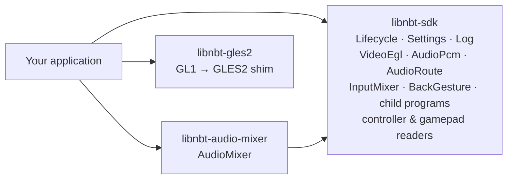
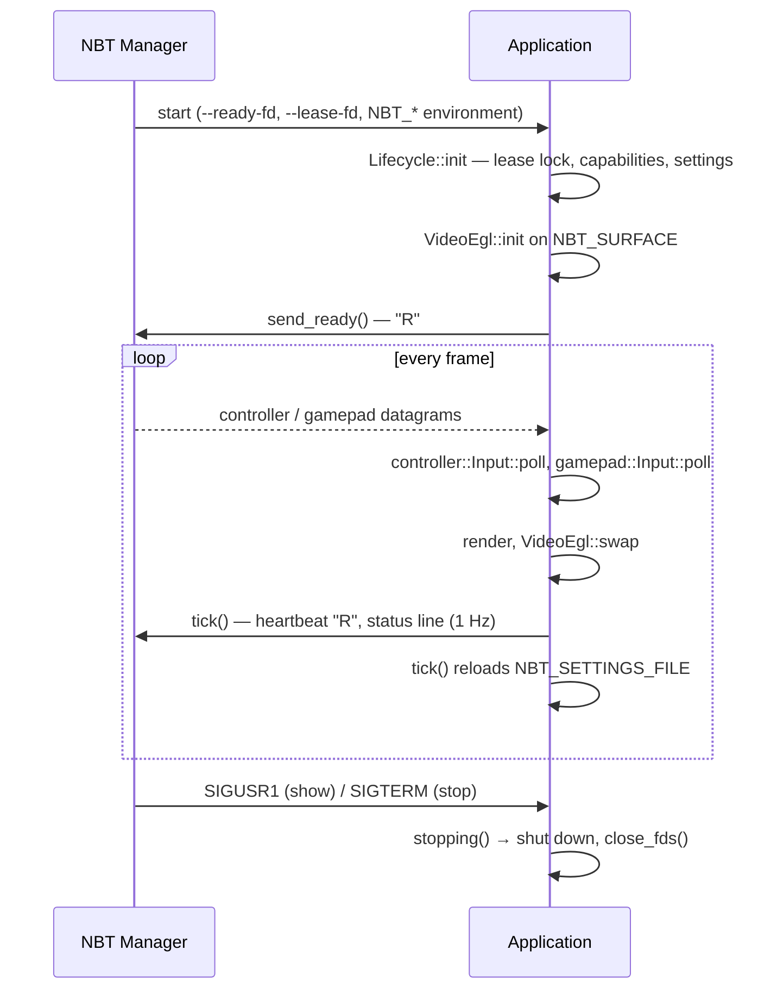
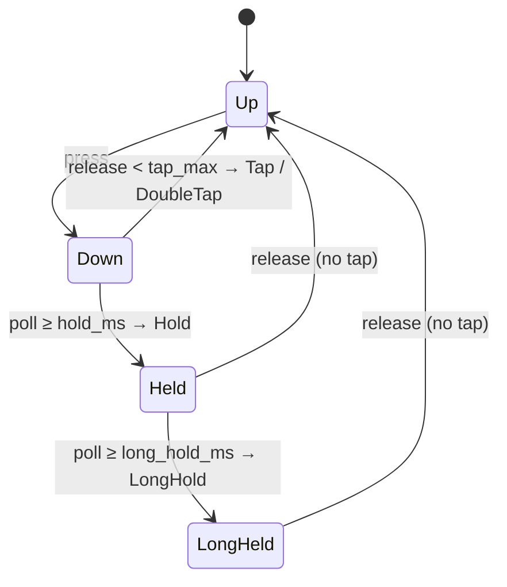

<!-- SPDX-License-Identifier: MPL-2.0 -->
# NBT App SDK API

Everything is in namespace `nbt::app` unless noted, under `include/nbt/`. The
SDK is C++11 without exceptions or RTTI, allocates nothing at start-up, and
has no static constructors. On the head unit it targets QNX 6.5 ARMv7.

## Libraries



| Library | Contents | Needs |
| --- | --- | --- |
| `libnbt-sdk` | everything in `src/` | libc, pthread, EGL, GLESv2; X11 on a host, Screen on QNX |
| `libnbt-audio-mixer` | `AudioMixer` | `libnbt-sdk` |
| `libnbt-gles2` | the GL1-to-GLES2 shim | GLESv2 |
| `libnbt-frontend` | frame drawing, audio queue, pad profiles, overlay, menus, save files | `libnbt-sdk`, GLESv2 |
| `libnbt-retro` | the libretro host | `libnbt-frontend`, a libretro core |

Link order: `libnbt-retro`, `libnbt-frontend`, `libnbt-audio-mixer`,
`libnbt-gles2`, `libnbt-sdk` (`NBT_SDK_FRONT_*_LIBS`; a core's objects before
them). On QNX, link
with `-Wl,--dynamic-list,qnx/exports.list` so that `kdMain` is exported:
libKD looks it up when the SDK opens it at run time.

## An application's main loop



```cpp
#include "nbt/app/clock.hpp"
#include "nbt/app/lifecycle.hpp"
#include "nbt/app/log.hpp"
#include "nbt/app/video.hpp"
#include "nbt/controller/input.hpp"

int main(int argc, char** argv) {
  nbt::app::log_init("hello");
  nbt::app::Lifecycle lifecycle;
  if (int rc = lifecycle.init(argc, argv)) return rc;
  nbt::app::log_install_crash_handlers();

  nbt::app::VideoEgl video;
  if (lifecycle.is_user_mode() && !video.init(lifecycle.surface_id())) return 1;
  if (!lifecycle.send_ready()) return 1;

  nbt::controller::Input controller;
  while (!lifecycle.stopping()) {
    const uint64_t now = nbt::app::monotonic_ms();
    controller.poll(lifecycle.controller_fd(), &on_controller, NULL);
    draw();
    video.swap();
    bool settings_changed = false;
    lifecycle.tick(now, "Running", &settings_changed);
    if (settings_changed) apply(lifecycle.settings());
  }
  video.shutdown();
  lifecycle.close_fds();
  return 0;
}
```

## Lifecycle — `nbt/app/lifecycle.hpp`

The application's side of the bridge described in
`NBTFoundry/manager: docs/app-bridge.md`. One instance per process.

| Call | Purpose |
| --- | --- |
| `int init(argc, argv)` | Parses `--ready-fd`/`--lease-fd` (both or neither), takes a shared lock on the lease, reads `NBT_LAUNCH`, `NBT_SURFACE`, `NBT_BRIDGE_CAPS` and the descriptors of granted capabilities, loads settings, installs signal handlers. Returns 0 (run), 1 (lease or surface unusable), 2 (usage error). |
| `static bool is_bridge_arg(arg)` | Whether `arg` is `--ready-fd` or `--lease-fd` (each takes a value), to strip them from argv. |
| `is_check_mode()`, `is_user_mode()`, `can_show()` | `NBT_LAUNCH=check` is a health check without display or input. |
| `has_cap(name)`, `bridge_caps()` | The granted capabilities. |
| `surface_id()`, `status_fd()`, `controller_fd()`, `gamepad_fd()` | Descriptors of granted capabilities, or -1. Input descriptors are validated datagram sockets, made non-blocking. |
| `data_dir()` | `NBT_DATA_DIR`, the application's private folder. |
| `settings()`, `settings_generation()` | `NBT_SETTING_*` values overlaid with `NBT_SETTINGS_FILE` (capability `live-settings`). |
| `send_ready()` | Writes the readiness byte. |
| `tick(now_ms, status, &changed)` | At most once a second: heartbeat, settings reload, status line. A failed heartbeat (the manager went away) stops the application. |
| `stopping()`, `request_stop()`, `consume_show_requested()` | SIGTERM/SIGINT stop; SIGUSR1 asks to come to the front; SIGPIPE is ignored. |
| `close_fds()` | Closes every bridge descriptor. |

## Settings — `nbt/app/settings.hpp`

`Settings` holds up to 16 key/value pairs (keys: 1–16 of `[a-z0-9_]`,
starting with a letter; values: 1–12 of `[a-z0-9_-]`). It does not know the
application's choices: the application maps the values onto its own settings
and ignores values it does not accept.

- `settings_load_env(&s)` adds `NBT_SETTING_<KEY>=<value>` (key lower-cased).
- `settings_read_file(path, &s, &reason)` reads the manager's snapshot,
  `NBTVALUES1\n` then `key=value\n` lines, with the manager's own checks: a
  regular file (no symlink), owned by the user, mode without group or other
  bits, one link, shorter than 372 bytes. One bad line rejects the file.
- `Settings::parse_values(text, size)` applies that format from memory.

## Log — `nbt/app/log.hpp`

Lines go to stderr, which the manager keeps as the application's log:
`[tag] message`, and `[tag][dbg] message` while debug is on. `log_stage()`
names the current stage, which a crash line repeats:

```
[hello] FATAL sig=11 code=1 addr=0x0 pc=0x... lr=0x... sp=0x... stage=render
[hello] pc in /lib/libc.so.3+0x3e8dc (memcpy+0x1c)
```

## Input

| Header | API |
| --- | --- |
| `nbt/controller/input.hpp` (`nbt::controller`) | `Input::poll(fd, deliver, ctx)` and `Input::feed()` decode capability `controller`: the iDrive knob (detents), push, tilts, MENU, BACK, OPTION, COM, MEDIA, NAV, MAP and the favourite keys 1–8. Keys count only after every key was seen up; a lost link releases them. |
| `nbt/gamepad/input.hpp` (`nbt::gamepad`) | `Input::poll(fd, now, deliver, ctx)` decodes capability `gamepad` (sequence, staleness, neutral arming); `Navigation` turns the D-pad into menu presses with repeat. `nbt_gamepad_axis()` applies a dead zone. |
| `nbt/app/input_mixer.hpp` | `InputMixer`: up to 4 sources × 512 keys; a key is down while any source holds it. `SourceSink` feeds one source. Types from `InputAction::kAppAction` pass through. |
| `nbt/app/back_gesture.hpp` | `BackGesture`: tap (release before 400 ms), double tap (second tap within 350 ms), hold (600 ms), long hold (1400 ms, before the manager's own 2000 ms BACK escape). `update()` takes the key level; `poll()` reports holds. Timings are configurable. |



## Video — `nbt/app/video.hpp`

`VideoEgl::init(surface_id, &config)` opens an OpenGL ES 2 window and makes its
context current, then shows a black frame so the manager can bind the surface.

- Head unit: a full-panel window bound to `NBT_SURFACE`, through libKD if it
  loads, else QNX Screen.
- Linux host: an X11 window (`config.host_title`, default size 1280×480).
  `poll_event()` reports key presses as `HostKey` values (printable ASCII
  lower-cased, or a named key), window resizes and the close button.

## Audio

| Header | API |
| --- | --- |
| `nbt/app/audio_pcm.hpp` | `AudioPcm::open(rate, render, ctx, route_wanted)`: stereo S16LE output through libasound loaded at run time (io-audio on the head unit, ALSA on a host) and a playback thread that calls `render`. `NBT_AUDIO_A2I=<io-amp input>` (from NBT Manager's Native audio setting) plays straight into that input of the head unit through its `liba2i_client` at 44100 Hz instead. `NBT_NO_AUDIO=1` skips the device. One instance per process. |
| `nbt/app/audio_a2i.hpp` | `A2iOutput`: blocking 16-bit stereo playback into one io-amp input through the head unit's `liba2i_client` (`NBT_A2I_LIB` for a test double); what `AudioPcm` uses under `NBT_AUDIO_A2I`. |
| `nbt/app/audio_route.hpp` | `AudioRoute`: builds and releases the head unit's audio connection with `audioconn` (default connection 0xb8). `NBT_AUDIO_CONN` overrides the connection (0 turns routing off), `NBT_AUDIOCONN` the binary, and `<data_dir>/audio-conn` names another connection. |
| `nbt/app/audio_mixer.hpp` | `AudioMixer` (libnbt-audio-mixer): 16 channels of 8-bit unsigned or 16-bit signed mono samples, each with a 16.16 step and left/right volume, mixed over an optional music renderer. Muting also releases the audio connection. |

## GL1 → GLES2 shim — `nbt/gles2/gles2_compat.h`

C99. Fixed-function calls (`glBegin`/`glEnd`, the matrix stack, `glColor`,
`glTexCoord`, client arrays, fog, `glAlphaFunc`, `glTexEnv`) mapped onto
GLES2 shaders and a vertex batch, for porting desktop OpenGL 1.x renderers.
Texture-coordinate generation and display lists are accepted and do nothing.
Include it instead of
`GL/gl.h`; call `gles2_batch_init()` once the context is current and
`gles2_batch_shutdown()` before it goes. `gles2_set_viewport_mapping()` and
`gles2_set_gamma()` control scaling and gamma. Errors are logged as
`[nbt-gles2] ...`.

## Files — `nbt/app/files.hpp`

An application granted `files` (bridge 1.5) reads the files the user sent
from the phone or imported from a USB stick in `Lifecycle::files_dir()`
(`NBT_FILES_DIR`); the folder is NBT Manager's, the application only reads
it. `FileList::load(dir, extensions)` lists it: regular files with names the
manager stores, the given extensions in any case, sorted without regard to
case, at most 512. `read(i, max, &size)` reads one into memory without
following a link. Saves and the like belong in `data_dir()`.

When one game is several files (a CD image's cue and bins), the package
declares `--bridge-files <exts>|<MiB>|<MiB>|folders=<exts>`, the extensions
of the file that makes a folder one game (`m3u,cue`): NBT Manager then imports
a folder, or a zip archive, from a USB stick holding one whole, as a game
folder (one level). `load(dir, extensions, folder_mains)` lists each game folder as one
entry: its name, the size of its files, and in `file` the file to open, the
one whose extension comes first in `folder_mains` (`{"m3u", "cue", ...}`);
`path(i)` gives that file's path. The retro front end takes the list as
`HostConfig::folder_mains`. Without `folder_mains`, folders are left out.

## Full-screen applications — bridge 1.6

For an application that places its own surface on the panel (Android Auto),
declared optional in its package (`tools/package.py --bridge 1.6
--bridge-optional hold,car-data,net`):

- **Focus hold** (`hold`): `Lifecycle::request_hold(kHold)` while on screen,
  `kPeek` while iDrive's own favourites bar is shown over it, `kRelease` when
  it leaves. `hold_state()` reads the answer: 1 held, 2 aside (iDrive took the
  screen: leave it; a new `kHold` comes back). Poll it from the main loop.
- **Car data** (`car-data`, signed `--bridge-cds name,name`):
  `nbt::app::CarData` (`nbt/app/car_data.hpp`), `init()` then
  `read(name, value, size, &sequence)`: iDrive's own text, usually JSON
  (`{"gear":2}`); nothing until the car gives a value.
- **Network** (`net`, signed `--bridge-net tcp:<port>@uap0+wfd0`): NBT Manager
  lets those connections in while the application runs;
  `Lifecycle::net_rules()` is the rules when they are open, else empty.

The wire formats are the manager's (`nbt/bridge_hold.h`, READERS); the
manager's `docs/app-bridge.md`, components 5-7, describes the rest.

## Other programs — `nbt/app/child.hpp`, `nbt/app/payload.h`

An application may start the head unit's tools, or a companion program it
carries: a second executable appended to its own (`$(NBT_SDK_APPEND) app
companion out`, `tools/nbt_payload.py`), so the manager still installs one
signed file.

- `extract_own_payload(dir, name, out, size, &why)` copies the appended
  program to `<dir>/<name>` (mode 0700), normally into `data_dir()`.
- `spawn_child(path, argv, envp, fds, count, own_group, &pid)` starts a
  program with a descriptor map (the child's descriptor i is `fds[i]`, -1
  closed, nothing else inherited), default signal actions and an empty mask:
  QNX `spawn()`, since QNX 6.5's `fork()` fails in a process with threads.
  With `own_group` it leads its own process group.
- `child_environment(environ, first, out, max, keep_preload)` gives a child
  `first` and then this process's environment without the variables `first`
  sets and, unless `keep_preload`, without `LD_PRELOAD`: iDrive preloads its
  graphics stack, which a tool must not load but a program with its own
  window needs.
- `child_exited(pid, &status)` and `stop_child(pid, group, wait_ms,
  term_ms)`: a grace period, then SIGTERM, then SIGKILL.

Modules and guests cannot start programs: there these report `ENOSYS`.

## Front end — `libnbt-frontend`, `nbt/frontend/`

For applications that draw a software frame (an emulator) or want the same
menus, notices and controls over their own renderer. Independent of
libretro.

| Header | API |
| --- | --- |
| `frame_video.hpp` | `FrameVideo`: uploads an RGB565, XRGB8888 or 0RGB1555 frame and draws it at its display aspect, an integer scale or stretched, turned by quarter turns (`FrameOptions::rotation`, libretro's `SET_ROTATION`); filters sharp (crisp pixels with smoothed edges), smooth or nearest. `place()` computes the rectangle. |
| `audio_queue.hpp` | `AudioQueue`: frames from the loop to `AudioPcm`'s thread, resampled to the device's rate, the ratio nudged (at most 0.5%) to hold its target fill. `render_callback` is an `AudioRenderFn`. |
| `pad_profiles.hpp` | `PadMapper`: the application's actions from a `PadProfile` per pad family (byte 3 of the gamepad state, bridge 1.5), a `ControllerProfile` (keys, knob detents as pulses, BACK tap, hold for the menu, long hold to quit) and a `KeyboardProfile`. An action is held while any source holds it; changes reach an `InputSink`. The profile follows the pad plugged in. |
| `hints.hpp` | Inputs and buttons named as printed: "Cross", "Create", "Push"... |
| `overlay.hpp` | `Overlay`: boxes and 8x8 text over the window's frame, restoring the GL state it changes. |
| `menu.hpp` | `Menu`: a list with a title and notes, drawn with the overlay; `MenuInput` turns pad, controller and keyboard into up, down, select and back, and a pad's shoulder buttons into pages of ten. A list holds a whole files folder. |
| `save_file.hpp` | Whole-file writes through a synced `.next` and a rename; bounded reads that do not follow links. |

Lay out each pad family's buttons by where they sit, so a game plays as on
its original controller: the south button is the bottom one on every pad.

## Libretro host — `libnbt-retro`, `nbt/retro/`

`retro::run(argc, argv, HostConfig)` runs one statically linked libretro
core as an NBT Manager application: the bridge's lifecycle (a health check
only reports ready), the window, sound, the controls by pad family, a game
list from the files folder (the last game focused), battery saves
(`<data>/saves/<game>.srm`, written when changed, at most every 10 s, and on
leaving), four save-state slots (`<data>/states/`) and a pause menu (Resume,
Save state, Load state, Slot, Reset, Choose another game, Quit). The menu
opens with a pad's Guide button or its View and Menu together, the iDrive
MENU key or a BACK hold; a long BACK hold quits.

A core with several discs for a game (`SET_DISK_CONTROL_INTERFACE` or its
`_EXT` form, e.g. from an `.m3u` list) gets a "Disc: n of N" row after Slot:
choosing it opens the lid, puts in the next disc and closes the lid. The
core's system folder (BIOS files) is the data folder, or the files folder
with `HostConfig::system_in_files`, so users add BIOS files as they add
games. `--game NAME` starts that file of the files folder instead of
showing the list (VM runs, measurements); an unknown name shows the list.

The list shows file names unless `HostConfig::describe` names the entries:
called for each file with the core initialised, it gives a label (an arcade
romset's title for `mslug.zip`) or leaves the entry out (a BIOS set); the list
is then in label order, and the label names the game in the pause menu and
the status. A core that asks for a rotation (`SET_ROTATION`, a game made for
a vertical screen) gets it; with `HostConfig::display_aspect` 0 the frame
takes the core's aspect ratio (its geometry's, as shown after the turn).

The front end's own settings: `aspect` (`4-3`, `pixel`, `full`), `filter`
(`sharp`, `smooth`, `nearest`), `sound`, `frameskip` (`off`, `auto`, `1`,
`2`: frames the core runs without drawing, for a core that asks with
`GET_AUDIO_VIDEO_ENABLE`; `auto` while the loop runs late), `show_fps`,
`debug_log`.
`VariableMap` entries feed core variables from other settings
(`CoreOptions`); a value the core does not list is never given to it. Cores
declare plain variables (`RETRO_ENVIRONMENT_SET_VARIABLES`): the host does not
answer `GET_CORE_OPTIONS_VERSION`. Software rendering only.

`tests/retro_app.cpp` is a complete small emulator application (with
`tests/fake_core.c` for a core).

## Helpers

- `nbt/app/clock.hpp`: `monotonic_ms()`.
- `nbt/app/parse.hpp`: `parse_int`, `parse_int_range`, `parse_bool`.
- `nbt/app/bridge.hpp`: `bridge_cap_has`, `bridge_status_sanitize`,
  `bridge_status_format`, `datagram_input_fd`.
- `nbt/app/version.hpp`: `NBT_APP_SDK_VERSION`.
